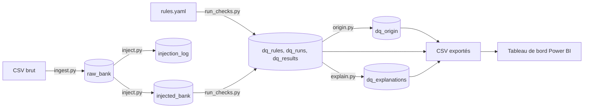
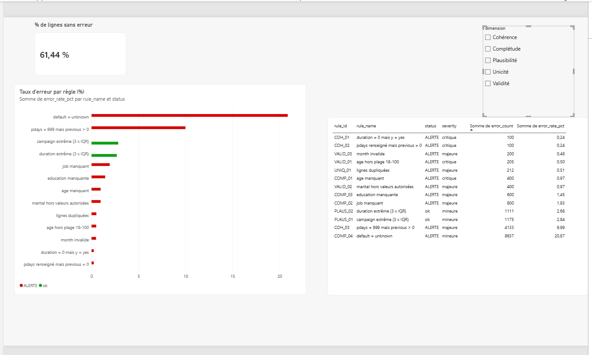
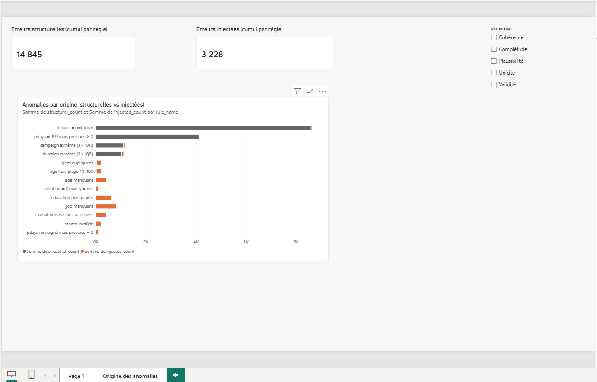

# Data Quality Copilot

Pipeline de contrôle de la qualité des données : il détecte les anomalies d'un jeu de données public, les mesure avec des règles SQL, stocke les résultats dans une base analytique, les affiche dans un tableau de bord Power BI et génère des explications à partir des résultats.

## Problématique

Comment détecter, mesurer et expliquer les problèmes de qualité des données afin de faciliter leur analyse et leur correction ?

## Données
   Jeu de données **Bank Marketing** (`bank-additional-full.csv`, 41 188 lignes, 20 colonnes), UCI Machine Learning Repository.
   
Ce jeu est déjà contrôlé à l'origine. J'y ai donc injecté **3 160 anomalies synthétiques** (valeurs manquantes, formats cassés, valeurs hors plage, incohérences, doublons) dans une copie, sans toucher aux données brutes. Chaque modification est tracée dans un journal d'injection, ce qui permet de vérifier que les règles retrouvent bien ce qui a été injecté.

## Architecture

Les tables sont stockées dans **DuckDB**. Les résultats des contrôles sont exportés en CSV dans `powerbi/data/` pour alimenter Power BI.

## Règles de qualité

13 règles, regroupées en 5 dimensions. Chacune est définie dans `rules/rules.yaml` avec un identifiant, une sévérité, un seuil d'alerte et une requête SQL qui renvoie les lignes en erreur. Une règle passe en **ALERTE** quand son taux d'erreur dépasse son seuil.

| Règle | Dimension | Sévérité | Seuil | Erreurs | Taux | Statut |
|---|---|---|---|---|---|---|
| COMP_01 age manquant | Complétude | critique | 0,5 % | 400 | 0,97 % | ALERTE |
| COMP_02 job manquant | Complétude | majeure | 1,0 % | 800 | 1,93 % | ALERTE |
| COMP_03 education manquante | Complétude | majeure | 1,0 % | 600 | 1,45 % | ALERTE |
| COMP_04 default = unknown | Complétude | mineure | 10,0 % | 8 637 | 20,87 % | ALERTE |
| VALID_01 age hors plage 18-100 | Validité | critique | 0,1 % | 205 | 0,50 % | ALERTE |
| VALID_02 marital hors valeurs autorisées | Validité | majeure | 0,5 % | 400 | 0,97 % | ALERTE |
| VALID_03 month invalide | Validité | majeure | 0,1 % | 200 | 0,48 % | ALERTE |
| COH_01 duration = 0 mais y = yes | Cohérence | critique | 0,1 % | 100 | 0,24 % | ALERTE |
| COH_02 pdays renseigné mais previous = 0 | Cohérence | critique | 0,1 % | 100 | 0,24 % | ALERTE |
| COH_03 pdays = 999 mais previous > 0 | Cohérence | majeure | 1,0 % | 4 133 | 9,99 % | ALERTE |
| PLAUS_01 campaign extrême (3 x IQR) | Plausibilité | mineure | 5,0 % | 1 175 | 2,84 % | ok |
| PLAUS_02 duration extrême (3 x IQR) | Plausibilité | mineure | 5,0 % | 1 111 | 2,68 % | ok |
| UNIQ_01 lignes dupliquées | Unicité | majeure | 0,1 % | 212 | 0,51 % | ALERTE |

## Résultats

Sur les 41 388 lignes contrôlées, **61,44 %** n'ont aucune erreur et **38,56 %** (15 958 lignes) en ont au moins une. **11 règles sur 13** sont en alerte.

### Anomalies structurelles et anomalies injectées

Pour chaque règle, j'ai appliqué la même requête aux données brutes afin de séparer ce qui est déjà dans la source de ce que j'ai injecté.

- Les gros volumes sont **déjà dans les données brutes** : 8 597 valeurs `unknown` dans `default`, 4 110 lignes où `pdays = 999` alors que `previous > 0`, et plus d'un millier de valeurs extrêmes pour `campaign` et `duration`.
- Les anomalies de complétude (âge, profession, études), de validité (marital, mois) et de cohérence (COH_01, COH_02) sont **toutes injectées** : aucune n'existe dans les données brutes.
- Le jeu d'origine contient aussi 5 âges inférieurs à 18 ans et 12 lignes dupliquées.

### Détection des anomalies injectées

Un test automatique prend chacune des 11 familles d'anomalies du journal d'injection et vérifie que la règle correspondante les retrouve : **100 % sont détectées**. Les 16 tests du projet passent (`python -m pytest -q`).