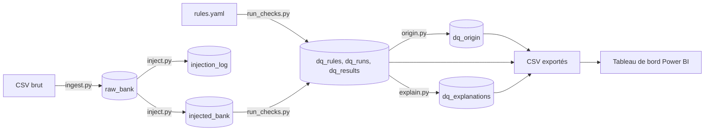

# Data Quality Copilot

Pipeline de contrôle de la qualité des données : il détecte les anomalies d'un jeu de données public, les mesure avec des règles SQL, stocke les résultats dans une base analytique, les affiche dans un tableau de bord Power BI et génère des explications à partir des résultats.

## Problématique

Comment détecter, mesurer et expliquer les problèmes de qualité des données afin de faciliter leur analyse et leur correction ?

## Données

Jeu de données **Bank Marketing** (`bank-additional-full.csv`, 41 188 lignes, 20 colonnes), UCI Machine Learning Repository.

Ce jeu est déjà contrôlé à l'origine. J'y ai donc injecté **3 160 anomalies synthétiques** (valeurs manquantes, formats cassés, valeurs hors plage, incohérences, doublons) dans une copie, sans toucher aux données brutes. Chaque modification est tracée dans un journal d'injection, ce qui permet de vérifier que les règles retrouvent bien ce qui a été injecté.

## Architecture

Les tables sont stockées dans **DuckDB**. Les résultats des contrôles sont exportés en CSV dans `powerbi/data/` pour alimenter Power BI.

*Les sections suivantes (règles, résultats, explications, limites, lancement) sont à venir.*