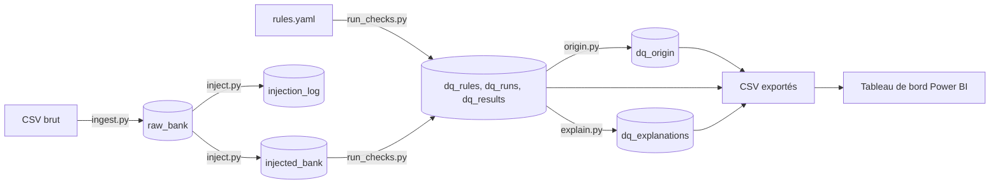

# Data Quality Copilot

Pipeline de contrôle de la qualité des données : il détecte les anomalies d'un jeu de données public, les mesure avec des règles SQL, stocke les résultats dans une base analytique, les affiche dans un tableau de bord Power BI et génère des explications à partir des résultats.

## Problématique

Comment détecter, mesurer et expliquer les problèmes de qualité des données afin de faciliter leur analyse et leur correction ?

## Données
   Jeu de données **Bank Marketing** (`bank-additional-full.csv`, 41 188 lignes, 20 colonnes), UCI Machine Learning Repository.
   
Ce jeu est déjà contrôlé à l'origine. J'y ai donc injecté **3 160 anomalies synthétiques** (valeurs manquantes, formats cassés, valeurs hors plage, incohérences, doublons) dans une copie, sans toucher aux données brutes. Chaque modification est tracée dans un journal d'injection, ce qui permet de vérifier que les règles retrouvent bien ce qui a été injecté.

## Architecture



Les tables sont stockées dans **DuckDB**. Les résultats des contrôles sont exportés en CSV dans `powerbi/data/` pour alimenter Power BI.

## Règles de qualité

13 règles, regroupées en 5 dimensions. Chacune est définie dans `rules/rules.yaml` avec un identifiant, une sévérité, un seuil d'alerte et une requête SQL qui renvoie les lignes en erreur. Une règle passe en **ALERTE** quand son taux d'erreur dépasse son seuil.

| Règle | Dimension | Sévérité | Seuil | Erreurs | Taux | Statut |
|---|---|---|---|---|---|---|
| COMP_01 age manquant | Complétude | critique | 0,5 % | 400 | 0,97 % | ALERTE |
| COMP_02 job manquant | Complétude | majeure | 1,0 % | 800 | 1,93 % | ALERTE |
| COMP_03 education manquante | Complétude | majeure | 1,0 % | 600 | 1,45 % | ALERTE |
| COMP_04 default = unknown | Complétude | mineure | 10,0 % | 8 637 | 20,87 % | ALERTE |
| VALID_01 age hors plage 18-100 | Validité | critique | 0,1 % | 205 | 0,50 % | ALERTE |
| VALID_02 marital hors valeurs autorisées | Validité | majeure | 0,5 % | 400 | 0,97 % | ALERTE |
| VALID_03 month invalide | Validité | majeure | 0,1 % | 200 | 0,48 % | ALERTE |
| COH_01 duration = 0 mais y = yes | Cohérence | critique | 0,1 % | 100 | 0,24 % | ALERTE |
| COH_02 pdays renseigné mais previous = 0 | Cohérence | critique | 0,1 % | 100 | 0,24 % | ALERTE |
| COH_03 pdays = 999 mais previous > 0 | Cohérence | majeure | 1,0 % | 4 133 | 9,99 % | ALERTE |
| PLAUS_01 campaign extrême (3 x IQR) | Plausibilité | mineure | 5,0 % | 1 175 | 2,84 % | ok |
| PLAUS_02 duration extrême (3 x IQR) | Plausibilité | mineure | 5,0 % | 1 111 | 2,68 % | ok |
| UNIQ_01 lignes dupliquées | Unicité | majeure | 0,1 % | 212 | 0,51 % | ALERTE |

## Résultats

Sur les 41 388 lignes contrôlées, **61,44 %** n'ont aucune erreur et **38,56 %** (15 958 lignes) en ont au moins une. **11 règles sur 13** sont en alerte.


### Anomalies structurelles et anomalies injectées

Pour chaque règle, j'ai appliqué la même requête aux données brutes afin de séparer ce qui est déjà dans la source de ce que j'ai injecté.


- Les gros volumes sont **déjà dans les données brutes** : 8 597 valeurs `unknown` dans `default`, 4 110 lignes où `pdays = 999` alors que `previous > 0`, et plus d'un millier de valeurs extrêmes pour `campaign` et `duration`.
- Les anomalies de complétude (âge, profession, études), de validité (marital, mois) et de cohérence (COH_01, COH_02) sont **toutes injectées** : aucune n'existe dans les données brutes.
- Le jeu d'origine contient aussi 5 âges inférieurs à 18 ans et 12 lignes dupliquées.

### Détection des anomalies injectées

Un test automatique prend chacune des 11 familles d'anomalies du journal d'injection et vérifie que la règle correspondante les retrouve : **100 % sont détectées**. Les 16 tests du projet passent (`python -m pytest -q`).

## Explications générées

Pour chaque règle en alerte, `src/explain.py` produit trois rubriques (cause probable, impact, correction suggérée) à partir des résultats des contrôles. Elles sont enregistrées dans la table `dq_explanations`, dans `powerbi/data/dq_explanations.csv` et dans [`docs/explications.md`](docs/explications.md).

Exemple, pour la règle COH_03 :

> **COH_03 : pdays = 999 mais previous > 0 (majeure)**
>
> - **Cause probable** : code de substitution du délai utilisé alors que des contacts précédents sont enregistrés, déjà présent dans la source. Sur 4133 lignes en erreur, 4110 sont déjà dans les données brutes et 23 sont apparues ensuite.
> - **Impact** : les statistiques sur le délai depuis le dernier contact sont peu fiables pour ces clients. Taux observé : 9,99 %, seuil d'alerte : 1 %.
> - **Correction suggérée** : documenter l'incohérence et traiter ces lignes à part dans les analyses sur le délai. Lignes à examiner en premier (row_id) : 24014, 24020, 24077, 24103, 24114.

**Ces explications ne sont pas produites par un modèle d'IA générative.** Les phrases sont rédigées à l'avance pour chaque règle, et seuls les chiffres viennent des résultats. J'avais prévu d'utiliser une API d'IA gratuite (GitHub Models), mais ce service a été retiré le 30 juillet 2026. Le choix a donc été de livrer des explications fiables plutôt qu'un appel à un service payant.

Le script est prévu pour accueillir un vrai modèle : il suffirait de remplacer la fonction `generer()`. Il comporte déjà un **contrôle des chiffres** : le texte doit contenir le nombre d'erreurs et le taux de la règle, et aucun autre nombre n'est accepté en dehors de ceux des résultats. Ce garde-fou est destiné à détecter un chiffre inventé par un modèle. Avec les phrases fixes actuelles, il sert surtout à repérer une erreur dans les modèles de texte.

## Limites connues

- **Pas d'IA générative** : voir la section précédente. Les explications sont des modèles de phrases complétés par les chiffres des contrôles.
- **Anomalies synthétiques** : les anomalies injectées sont artificielles et la graine est fixe (`42`). Les seuils d'alerte sont des choix personnels, pas des normes métier.
- **Colonnes numériques** : elles gardent leur type, donc je n'ai pas pu y injecter de texte cassé (par exemple `"abc"` dans `age`). Les erreurs de format portent sur les colonnes texte.
- **Séparation structurel / injecté** : un doublon injecté est une copie d'une ligne d'origine, qui en reprend les défauts (par exemple `unknown` dans `default`). Ces copies sont comptées comme « injectées » pour COMP_04 (40 lignes), COH_03 (23) et, dans une moindre mesure, PLAUS_01 et PLAUS_02.
- **Cumuls par règle** : une même ligne peut déclencher plusieurs règles. Les cartes « erreurs structurelles » et « erreurs injectées » sont donc des cumuls par règle, pas des nombres de lignes. Le nombre de lignes avec au moins une erreur est donné séparément (15 958).
- **Un seul run** : l'historique contient pour l'instant une seule exécution. Le suivi dans le temps n'est donc pas encore démontré, et la table `dq_origin` n'est reliée à `dq_runs` que via les règles dans Power BI.
- **Cause de `pdays = 999`** : pour 4 110 clients, le délai est codé 999 (« jamais contacté ») alors que `previous` indique des contacts précédents. Je n'en connais pas la cause, et je ne la suppose pas.
- **Power BI** : les CSV sont chargés à la main, il n'y a pas d'actualisation automatique.
- **Base DuckDB** : le fichier `data/dq.duckdb` n'est pas versionné. Il se recrée en relançant les scripts dans l'ordre.

## Lancer le projet

Le projet a été développé dans GitHub Codespaces (Python 3.14, Linux). Les commandes ci-dessous supposent un terminal Linux ou macOS.

```bash
git clone https://github.com/FatoumataMBALLO/data-quality-copilot.git
cd data-quality-copilot
python -m venv .venv
source .venv/bin/activate
pip install -r requirements.txt
bash run_all.sh
```

`run_all.sh` reconstruit tout de zéro : il supprime la base, recharge le CSV, injecte les anomalies, exécute les 13 règles, sépare les anomalies structurelles et injectées, génère les explications, puis lance les tests. L'historique des exécutions repart donc au run n°1.

Pour lancer les étapes une par une :

| Étape | Commande | Rôle |
|---|---|---|
| 1 | `python src/ingest.py` | Charge le CSV dans DuckDB (`raw_bank`) |
| 2 | `python src/inject.py` | Crée `injected_bank` et le journal d'injection |
| 3 | `python src/run_checks.py` | Exécute les règles, remplit `dq_rules`, `dq_runs`, `dq_results` |
| 4 | `python src/origin.py` | Sépare anomalies structurelles et injectées (`dq_origin`) |
| 5 | `python src/explain.py` | Génère les explications (`dq_explanations`) |
| 6 | `python -m pytest -q` | Lance les 16 tests |

`src/explore.py` et `src/preview_rules.py` sont des scripts d'exploration, utiles pour comprendre les données et tester les règles, mais non nécessaires au pipeline.

### Tableau de bord Power BI

Les CSV de `powerbi/data/` (`dq_rules`, `dq_runs`, `dq_results`, `dq_origin`, `dq_explanations`) sont la source du tableau de bord. Dans Power BI Desktop : **Obtenir les données** > **Texte/CSV**, puis relier `dq_results` à `dq_rules` (par `rule_id`) et à `dq_runs` (par `run_id`), et `dq_origin` à `dq_rules`. Des captures se trouvent dans `powerbi/screenshots/`.

## Structure du dépôt

```
data-quality-copilot/
├── data/raw/            # CSV d'origine, jamais modifié
├── data/injected/       # journal d'injection (CSV)
├── docs/                # explications générées
├── powerbi/data/        # CSV pour Power BI
├── powerbi/screenshots/ # captures du tableau de bord
├── rules/rules.yaml     # définition des 13 règles
├── src/                 # scripts Python
├── tests/               # tests automatiques
├── run_all.sh           # reconstruit tout le projet
└── requirements.txt
```

## Source des données

Moro, S., Rita, P. et Cortez, P. (2014), *Bank Marketing*, UCI Machine Learning Repository.